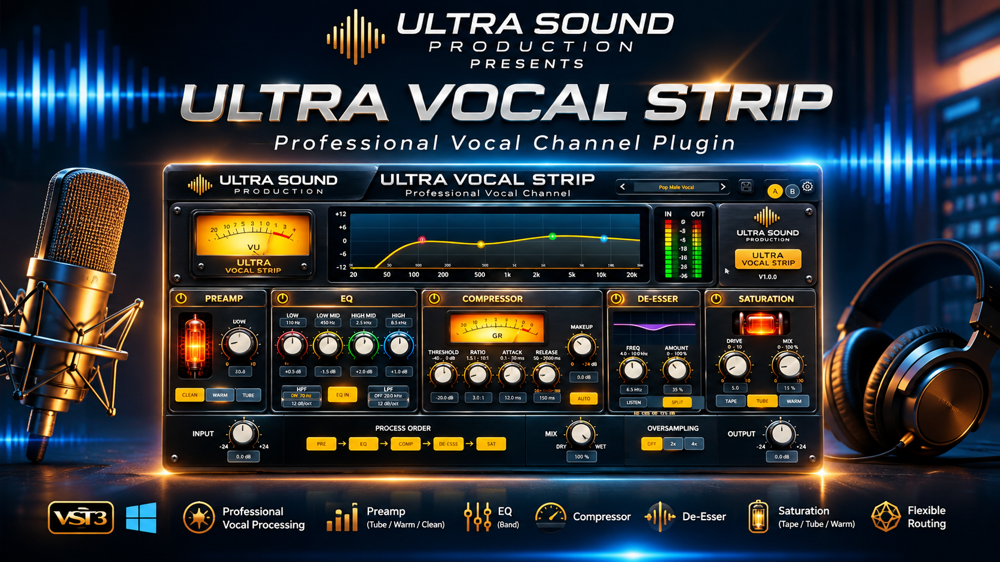

# ULTRA VOCAL STRIP

### Professional Vocal Channel Strip – VST3 for Windows

Developed by **ULTRA SOUND PRODUCTION**.

ULTRA VOCAL STRIP is an all-in-one vocal processing plugin designed for music producers, recording engineers, mixing engineers and home studio users.

It combines essential vocal processing tools into a single, intuitive interface, inspired by classic analog studio equipment.

## Key Features

- **Preamp** – Tube, Warm and Clean tonal characteristics.
- **Equalizer** – 4-band EQ for precise vocal shaping.
- **Compressor** – Dynamic control for smooth and consistent vocals.
- **De-Esser** – Control unwanted vocal sibilance.
- **Saturation** – Tape, Tube and Warm harmonic coloration.
- **Flexible Signal Routing** – Customizable processing order.
- **Input and Output Gain Controls**
- **Dry/Wet Mix Control**
- **Oversampling**
- **Real-Time EQ Visualization**
- **Analog-Style VU Metering**

## Designed For

- Professional vocal mixing
- Music production
- Lead and backing vocals
- Studio recording
- Voice-over and podcast processing

## System Requirements

- Windows PC
- VST3-compatible DAW
- macOS is not currently supported.

## Installation

1. Download and extract the plugin package.
2. Copy the VST3 plugin into your VST3 folder:

   `C:\Program Files\Common Files\VST3`

3. Restart your DAW or rescan your plugins.
4. Insert ULTRA VOCAL STRIP on your vocal track.

## Download

Download information and future updates will be published on this page.

## Developer

**ULTRA SOUND PRODUCTION**

Independent audio software development and professional music production.

Contact: studioultrasound@gmail.com

© 2026 Ultra Sound Production. All rights reserved.
